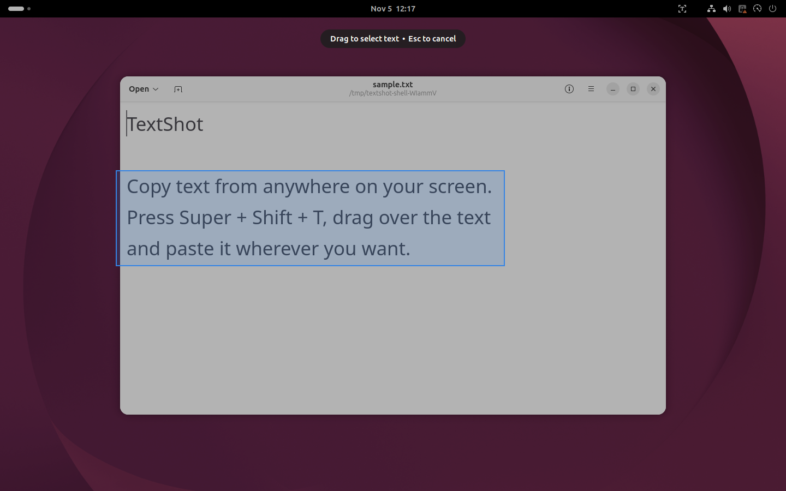
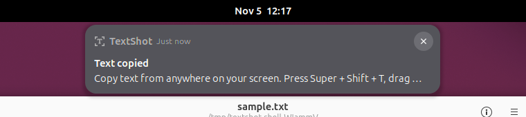
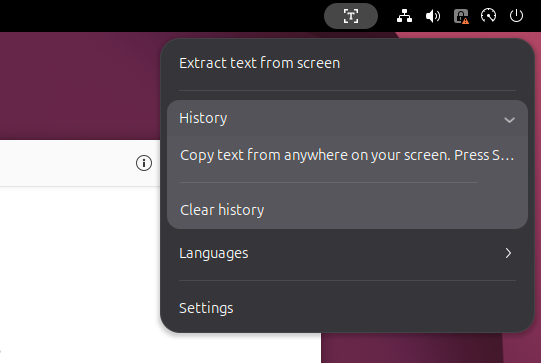
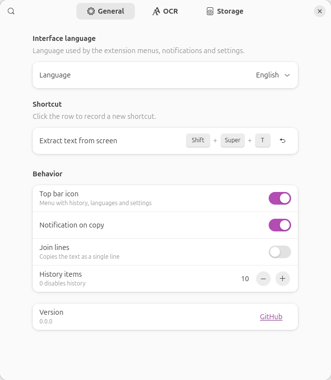
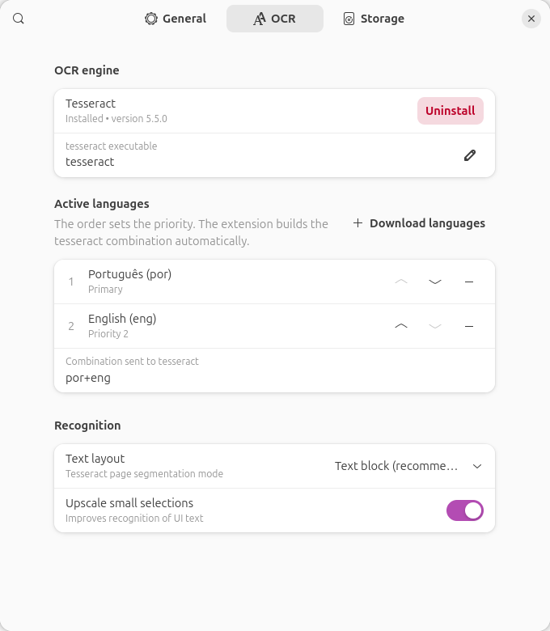
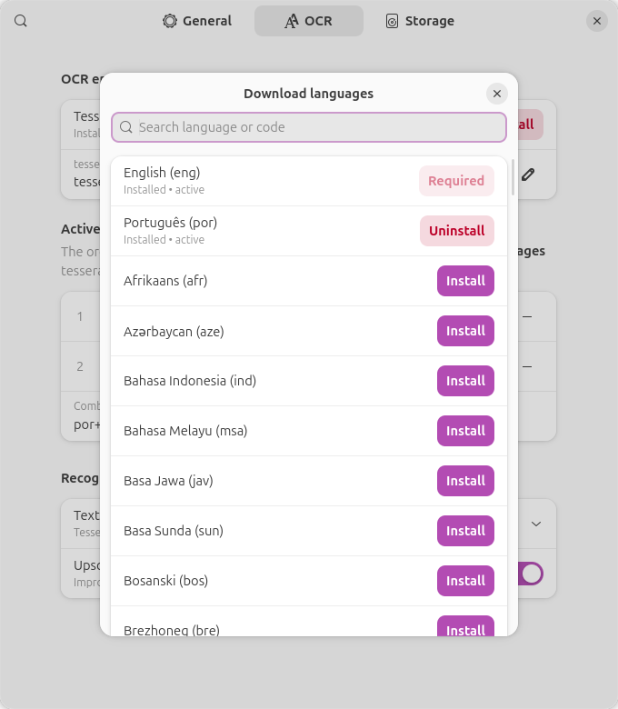
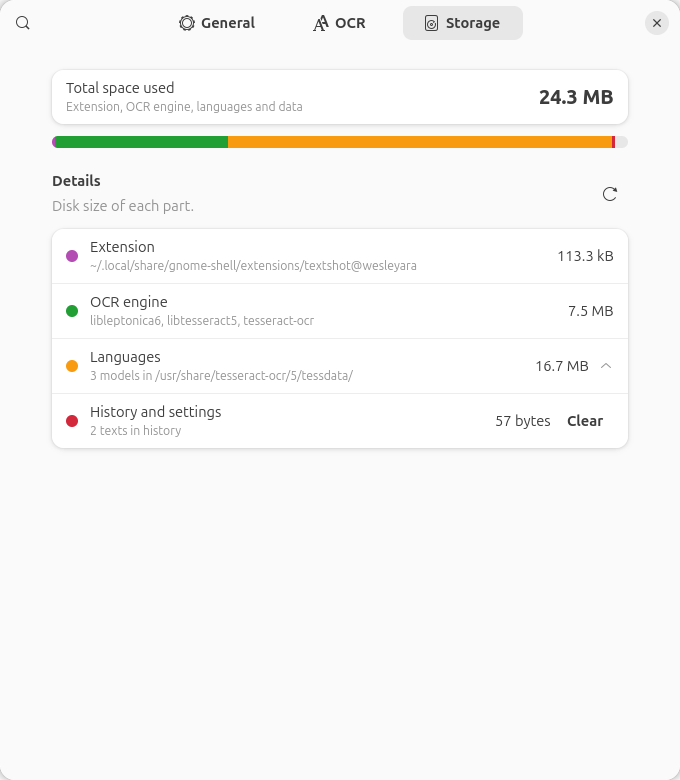

# TextShot

**Copy text from anywhere on your screen.** Press a shortcut, drag over any area and the recognized text goes straight to your clipboard. A GNOME Shell extension inspired by the *Text Extractor* in Microsoft PowerToys.

[Português (Brasil)](README.pt-BR.md)



## Features

- **One shortcut**: <kbd>Super</kbd> + <kbd>Shift</kbd> + <kbd>T</kbd> (configurable). Drag to select, release to copy
- **Works on Wayland and X11**, with no screenshot permission prompt
- **Private**: OCR runs locally with [Tesseract](https://github.com/tesseract-ocr/tesseract). Nothing leaves your computer
- **100+ recognition languages**, used in the order you choose
- **Installs its own dependencies**: one click and your system password
- **History** of extracted text in the top bar menu
- **Storage page** showing how much space the extension and its languages use
- **Interface in** English, Português (Brasil), Español, Deutsch, Italiano and 中文（简体）

## Requirements

- GNOME Shell 50
- Tesseract. The extension offers to install it on first use (via PackageKit) on:
  - Debian / Ubuntu and derivatives
  - Fedora and derivatives
  - Arch Linux and derivatives (needs PackageKit; otherwise the extension shows the `pacman` command)

## Installation

### From extensions.gnome.org

Install **TextShot** from [extensions.gnome.org](https://extensions.gnome.org/) or from the **Extension Manager** app.

### From source

```bash
git clone https://github.com/wesleyara/TextShot.git
cd TextShot
make install
```

Log out and back in (required on Wayland), then:

```bash
make enable
```

### First run

A few seconds after the extension is enabled, a notification appears if Tesseract is missing:

> **TextShot**: The tesseract OCR engine needs to be installed. **[Install]**

Click **Install** and enter your password. You can also do this from **Settings → OCR**.

<details>
<summary>Manual installation</summary>

```bash
# Debian / Ubuntu
sudo apt install tesseract-ocr tesseract-ocr-eng tesseract-ocr-por
# Fedora
sudo dnf install tesseract tesseract-langpack-eng tesseract-langpack-por
# Arch
sudo pacman -S tesseract tesseract-data-eng tesseract-data-por
```
</details>

## Usage

1. Press <kbd>Super</kbd> + <kbd>Shift</kbd> + <kbd>T</kbd>
2. Drag a rectangle over the text
3. Release: the text is copied and a notification shows a preview
4. Paste anywhere with <kbd>Ctrl</kbd> + <kbd>V</kbd>

<kbd>Esc</kbd> or a right click cancels the selection.



The **top bar icon** gives you: *Extract text from screen*, *History* (click an item to copy it again), *Languages* (quick on/off) and *Settings*.



## Settings

### General



Interface language, keyboard shortcut (click the row and press the new combination; <kbd>Backspace</kbd> disables it), top bar icon, notification, *Join lines* (copy everything as one line) and history size.

### OCR



- **OCR engine**: shows whether Tesseract is installed and its version, with **Install** / **Uninstall**
- **Active languages**: the languages used for recognition, in priority order. Use ↑ / ↓ to reorder and − to disable. The extension builds the Tesseract combination (e.g. `por+eng`) for you
- **Download languages**: search and install any of the 100+ languages. Installed ones show **Uninstall**
- **Text layout**: *Text block* (default), *Single line*, *Text columns*, *Sparse text* or *Automatic*
- **Upscale small selections**: improves recognition of small UI text



### Storage



Total disk usage with a breakdown: extension files, OCR engine packages, each language model and the saved history (with a **Clear** button).

## Tips

- For a single field or line (a code, an e-mail), set **Text layout → Single line**
- Fewer active languages make recognition faster and more accurate
- If the shortcut does nothing, check that no other shortcut uses the same keys (*Settings → Keyboard → Keyboard Shortcuts*)

## Development

```bash
make install      # build and install to ~/.local/share/gnome-shell/extensions
make nested       # run a nested GNOME Shell in a window (test without logging out)
make log          # follow GNOME Shell logs
make prefs        # open the settings window
make check        # validate schema, metadata, JavaScript and translations
make screenshots  # regenerate the settings screenshots (general, ocr, storage…)
make shell-screenshots  # regenerate selection/menu/notification in an isolated headless GNOME Shell
make pack         # build dist/textshot@wesleyara.shell-extension.zip
make test         # release helper tests
make uninstall
```

### Releases

Work happens on `develop` with [Conventional Commits](https://www.conventionalcommits.org). On a clean, synced `develop`, `make release-patch|minor|major` bumps `version-name` in `metadata.json`, writes the `CHANGELOG.md` section from the commits since the last tag (plus anything under `[Unreleased]`), commits, tags `vX.Y.Z` and pushes. Merging the develop → main PR publishes the GitHub release with the extension zip. `make release-dry-run KIND=minor` previews it. See [docs/PUBLISHING.md](docs/PUBLISHING.md).

```
gnome-extension/
├── metadata.json
├── extension.js      # shortcut, area selection, capture, OCR, clipboard, top bar menu
├── prefs.js          # settings window (libadwaita)
├── lib.js            # tesseract, package installation (PackageKit), storage
├── i18n.js           # interface language and the _() function
├── translations.js   # translations (key = English text)
├── stylesheet.css
├── icons/
└── schemas/
scripts/              # release flow (release.mjs, release-lib.mjs, changelog-notes.mjs, pack.sh)
tests/                # node --test
tools/
├── check_translations.py
├── screenshots.js         # settings screenshots
├── shell-screenshots.sh   # shell screenshots (headless, isolated session)
└── shell-helper/          # helper extension used only by shell-screenshots.sh
```

### Translations

Source strings are in English inside `_('...')`. `gnome-extension/translations.js` maps each English string to its translation. Keep placeholders such as `{n}` or `{lang}`. To add a language, add its code to `UI_LANGUAGES` in `i18n.js`, to the `ui-language` `<choices>` in the schema and a new block in `translations.js`, then run `make check`.

## License

[GPL-2.0-or-later](LICENSE)
