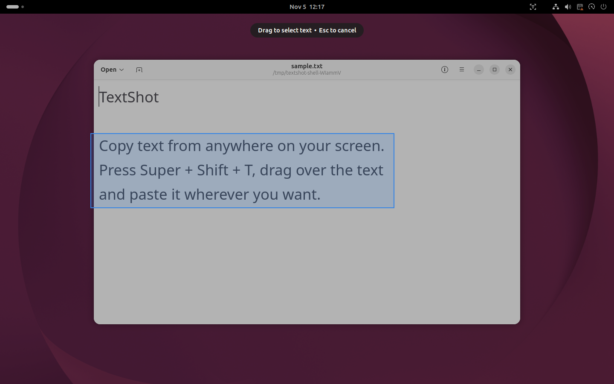
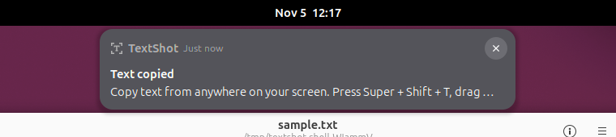
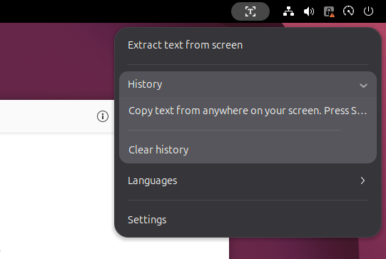
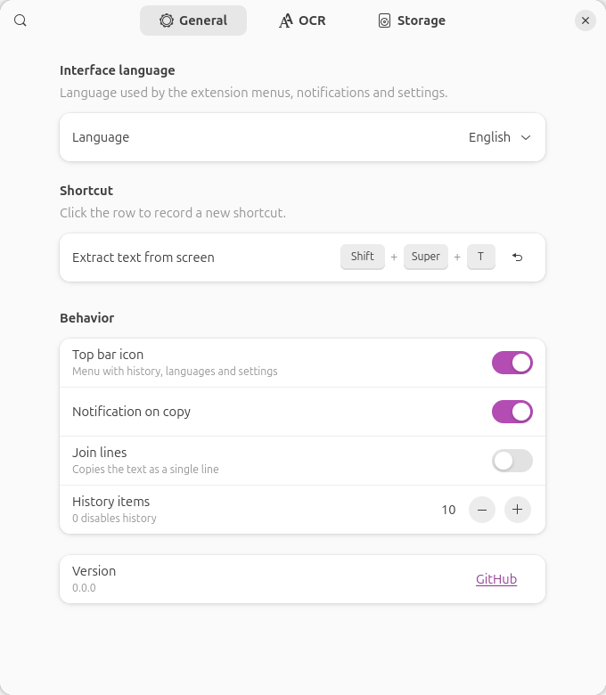
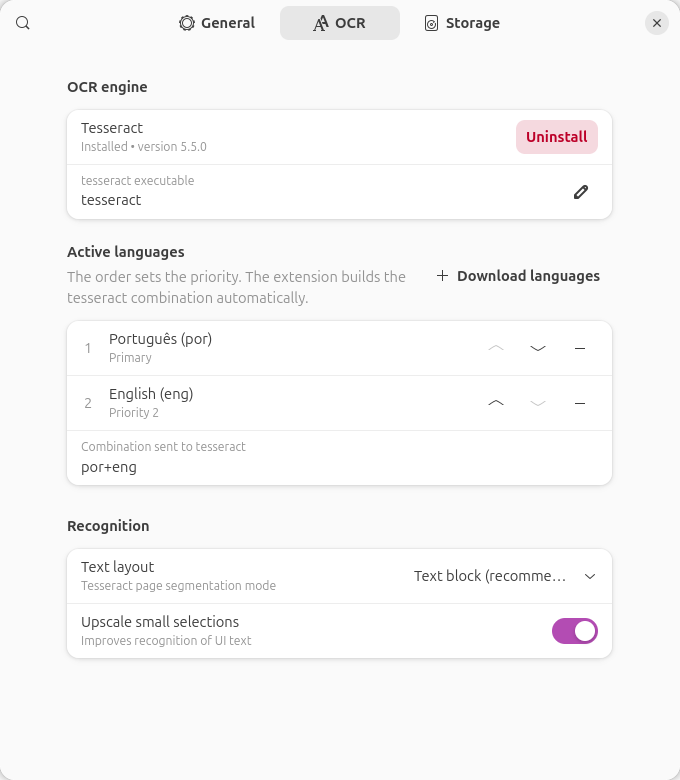
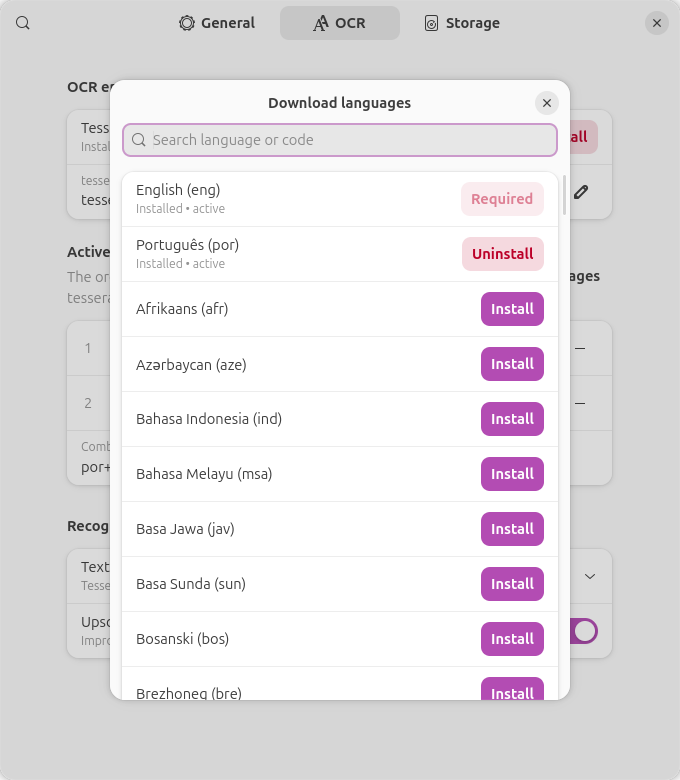
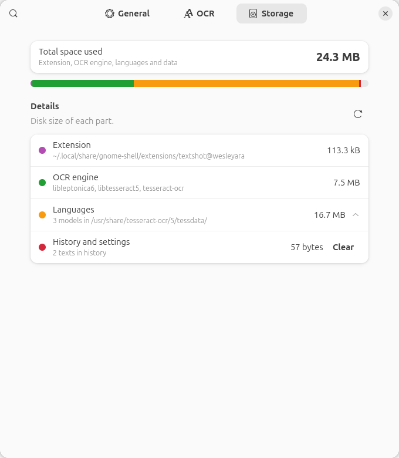

# TextShot

**Copie texto de qualquer lugar da tela.** Aperte um atalho, arraste sobre qualquer área e o texto reconhecido vai direto para a área de transferência. Uma extensão do GNOME Shell inspirada no *Text Extractor* do Microsoft PowerToys.

[English](README.md)



## Recursos

- **Um atalho**: <kbd>Super</kbd> + <kbd>Shift</kbd> + <kbd>T</kbd> (configurável). Arraste para selecionar e solte para copiar
- **Funciona no Wayland e no X11**, sem pedir permissão de captura de tela
- **Privado**: o OCR roda no seu computador com o [Tesseract](https://github.com/tesseract-ocr/tesseract). Nada é enviado para fora
- **Mais de 100 idiomas de reconhecimento**, usados na ordem que você escolher
- **Instala as próprias dependências**: um clique e a senha do sistema
- **Histórico** dos textos extraídos no menu do painel
- **Página de armazenamento** mostrando quanto espaço a extensão e os idiomas ocupam
- **Interface em** English, Português (Brasil), Español, Deutsch, Italiano e 中文（简体）

## Requisitos

- GNOME Shell 46, 47, 48, 49 ou 50 (veja [Compatibilidade](#compatibilidade))
- Tesseract. A extensão oferece a instalação no primeiro uso (via PackageKit) em:
  - Debian / Ubuntu e derivados
  - Fedora e derivados
  - Arch Linux e derivados (precisa do PackageKit; sem ele, a extensão mostra o comando `pacman`)

## Instalação

### Pelo extensions.gnome.org

Instale o **TextShot** pelo [extensions.gnome.org](https://extensions.gnome.org/) ou pelo app **Extension Manager**.

### Pelo código-fonte

```bash
git clone https://github.com/wesleyara/TextShot.git
cd TextShot
make install
```

Saia e entre na sessão (obrigatório no Wayland) e depois:

```bash
make enable
```

### Primeiro uso

Alguns segundos depois de ativar a extensão, se o Tesseract estiver faltando, aparece uma notificação:

> **TextShot**: É preciso instalar o tesseract (motor de OCR). **[Instalar]**

Clique em **Instalar** e digite sua senha. Também dá para fazer isso em **Configurações → OCR**.

<details>
<summary>Instalação manual</summary>

```bash
# Debian / Ubuntu
sudo apt install tesseract-ocr tesseract-ocr-eng tesseract-ocr-por
# Fedora
sudo dnf install tesseract tesseract-langpack-eng tesseract-langpack-por
# Arch
sudo pacman -S tesseract tesseract-data-eng tesseract-data-por
```
</details>

Se a instalação falhar com *"Há uma instalação anterior interrompida no sistema"*, rode `sudo dpkg --configure -a` e tente de novo.

## Uso

1. Pressione <kbd>Super</kbd> + <kbd>Shift</kbd> + <kbd>T</kbd>
2. Arraste um retângulo sobre o texto
3. Solte: o texto é copiado e uma notificação mostra o começo dele
4. Cole onde quiser com <kbd>Ctrl</kbd> + <kbd>V</kbd>

<kbd>Esc</kbd> ou o botão direito cancelam a seleção.



O **ícone no painel** oferece: *Extrair texto da tela*, *Histórico* (clique para copiar de novo), *Idiomas* (liga/desliga rápido) e *Configurações*.



## Configurações

As capturas mostram a interface em inglês, o idioma padrão; ela pode ser trocada em **General → Interface language**.

### Geral



Idioma da interface (o padrão é inglês), atalho de teclado (clique na linha e pressione a nova combinação; <kbd>Backspace</kbd> desativa), ícone no painel, notificação, *Juntar linhas* (copia tudo em uma linha) e tamanho do histórico.

### OCR



- **Motor de OCR**: mostra se o Tesseract está instalado e a versão, com **Instalar** / **Desinstalar**
- **Idiomas ativos**: os idiomas usados no reconhecimento, em ordem de prioridade. Use ↑ / ↓ para reordenar e − para desativar. A extensão monta a combinação do Tesseract (ex.: `por+eng`) sozinha
- **Baixar idiomas**: busque e instale qualquer um dos mais de 100 idiomas. Os já instalados mostram **Desinstalar**
- **Layout do texto**: *Bloco de texto* (padrão), *Linha única*, *Colunas de texto*, *Texto esparso* ou *Automático*
- **Ampliar seleções pequenas**: melhora o reconhecimento de textos pequenos de interface



### Armazenamento



Uso total em disco, dividido em: arquivos da extensão, pacotes do motor de OCR, cada modelo de idioma e o histórico salvo (com botão **Limpar**).

## Compatibilidade

Cada versão suportada foi testada num GNOME Shell real (`make compat-test`): a extensão ativa sem erros, selecionar uma área copia exatamente o texto reconhecido, o menu do painel abre e todas as páginas de configurações aparecem.

| GNOME Shell | Testado em | Resultado |
| --- | --- | --- |
| 50 | Ubuntu 26.04 | ✅ |
| 49 | Fedora 43 (49.10) | ✅ |
| 48 | Fedora 42 (48.8) | ✅ |
| 47 | Fedora 41 (47.10) | ✅ |
| 46 | Ubuntu 24.04 LTS (46.0) | ✅ |
| 45 ou anterior | | ❌ Não suportado (APIs de notificação e de configurações diferentes) |

Distribuições populares por versão do GNOME: Ubuntu 24.04 LTS (46), Ubuntu 24.10 (47), Ubuntu 25.04 e Debian 13 (48), Fedora 41 (47), 42 (48), 43 (49).

## Dicas

- Para um único campo ou linha (um código, um e-mail), use **Layout do texto → Linha única**
- Menos idiomas ativos deixam o reconhecimento mais rápido e preciso
- Se o atalho não fizer nada, confira se outro atalho usa as mesmas teclas (*Configurações → Teclado → Atalhos de teclado*)

## Desenvolvimento

Veja a seção *Development* do [README em inglês](README.md#development). O guia de publicação está em [docs/PUBLISHING.md](docs/PUBLISHING.md).

## Licença

[GPL-2.0-or-later](LICENSE)
